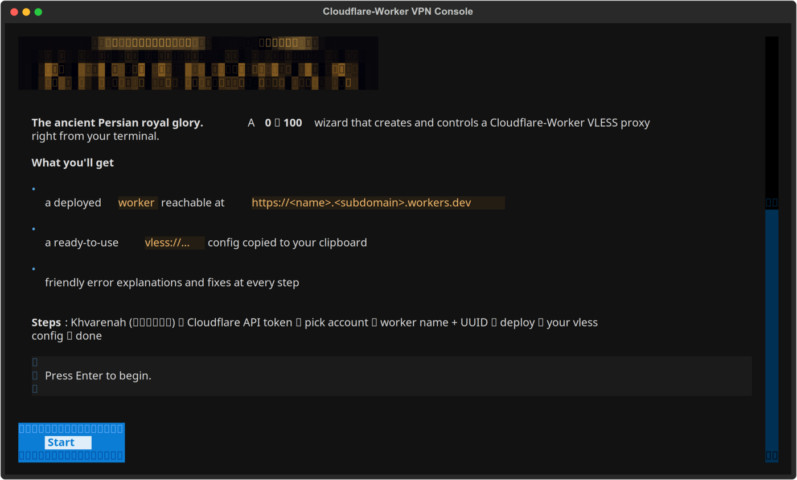
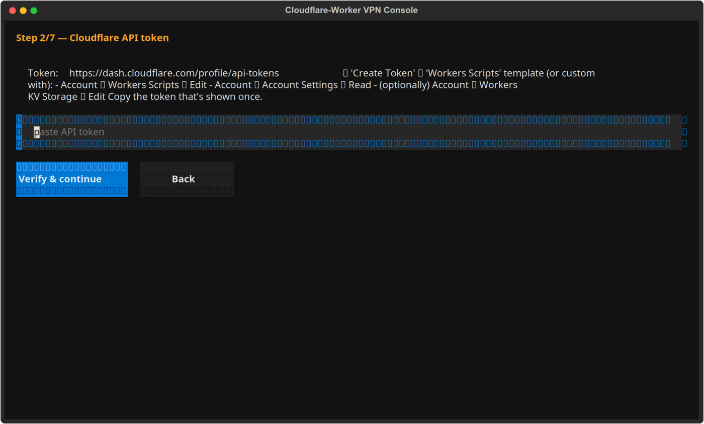
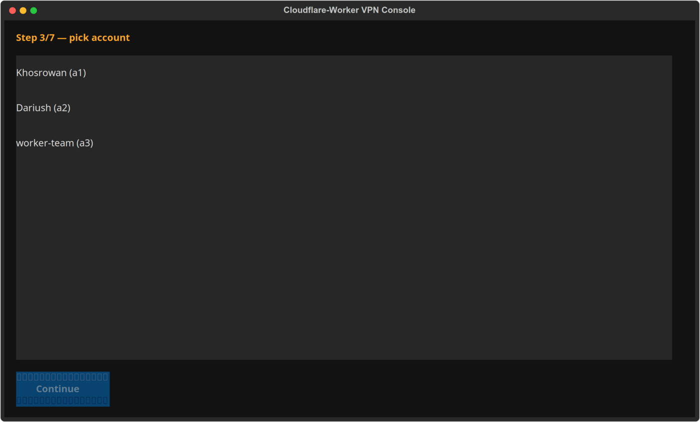
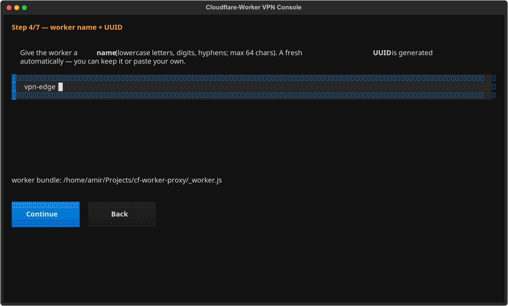
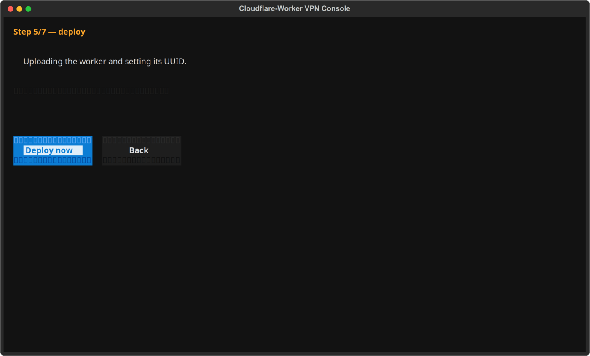
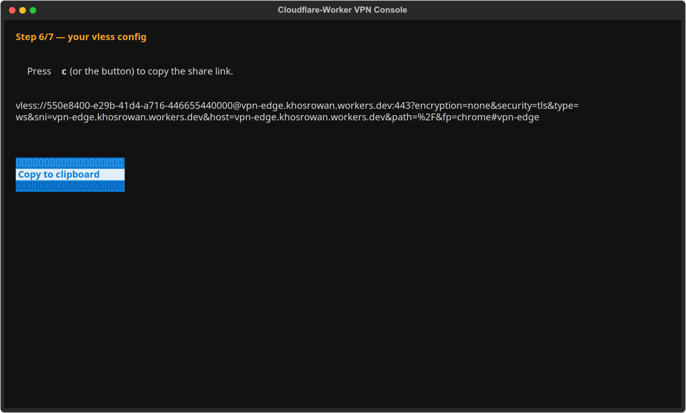
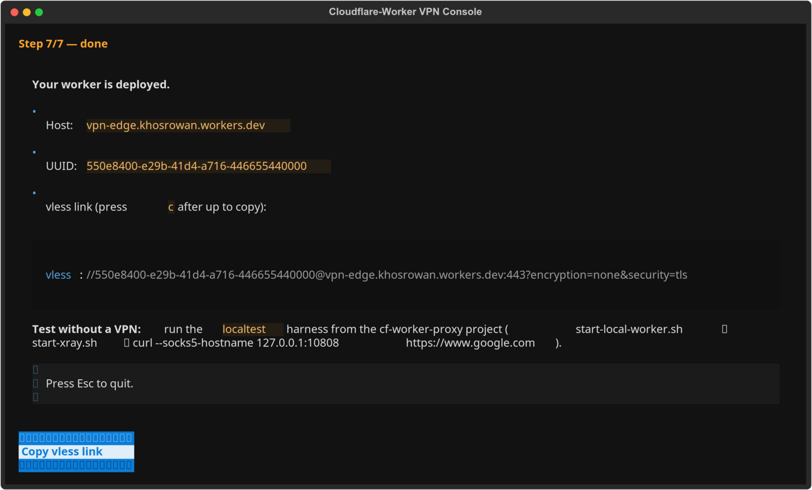

<div align="center">

# ✦ Khvarenah (خوَرنه) · **Khosrowan**

**The ancient Persian royal glory — a Cloudflare-Worker VLESS VPN console in your terminal.** *(Khvarenah — also spelled Khovarenah, خوَرنه — the Avestan divine glory.)*

Create and control a Cloudflare-Worker VLESS VPN — from zero to 100, entirely from your terminal. Cross-platform (Linux · Windows) · Interactive TUI wizard + headless CLI · Friendly error explanations.

[](https://python.org)
[](https://github.com/DariushKhosrowan/khvarenah)
[](LICENSE)
[](https://dariushkhosrowan.github.io/khvarenah/)
[](https://khosrowan.ir)
[](https://t.me/Khosrowan_ir)

**A modern terminal console that walks you through deploying a Cloudflare Workers proxy (VLESS over WebSocket) — verify your token, pick an account, deploy the worker, and get a ready-to-copy `vless://` config. If anything goes wrong, it tells you *what* the problem is and *how to fix it* — not a raw stack trace.**

**A [Khosrowan](https://khosrowan.ir) tool · [@Khosrowan_ir](https://t.me/Khosrowan_ir) on Telegram**

</div>

---

## 🎬 The console in action

The interactive wizard guides you **0 → 100** — welcome, token, account, worker, deploy, config, done:



| Token | Account | Worker |
|---|---|---|
|  |  |  |

| Deploy | Config | Done |
|---|---|---|
|  |  |  |

---

## ✦ What is Khvarenah?

**خوَرنه (Khvarenah)** is the Avestan term for *divine royal glory / radiance* — a sacred inner fire that lets one rise above every barrier. That is exactly what this tool does: it gives you the glory to reach over censorship walls. The app greets you with the golden Khosrowan emblem, rendered as true-color terminal art.

## ✨ Why Khvarenah?

| Pain point | What Khvarenah does |
|---|---|
| Setup is a maze of dashboards & APIs | A **0 → 100 wizard**: token → account → deploy → config, all in one place |
| Raw JSON/stack-trace errors | **Friendly error understanding**: every Cloudflare API & wrangler error → *problem + fix* |
| No CLI on Linux *and* Windows | Works identically on both, with native launchers |
| Need to paste a config into a client | Generates the `vless://` share link + xray client JSON, copies to clipboard |
| Workers.dev DNS-blocked in censored regions | Built-in **clean-IP finder** (SenPaiScanner) + **VPN-free local test** harness |

---

## 🚀 Quick install

### For non-programmers (recommended)

Install the **.deb** (Linux) or **.exe** (Windows) from
[GitHub Releases](https://github.com/DariushKhosrowan/khvarenah/releases) —
both bundle Python, so nothing else is needed.

**Linux** — one command (no git, no pip, no coding):

```bash
curl -fsSL https://raw.githubusercontent.com/DariushKhosrowan/khvarenah/main/install.sh | bash
```

…or grab the `.deb` directly (note: the `./khvarenah_*.deb` glob only works if a matching file is in the current folder, so download it first):

```bash
curl -fsSL -o /tmp/khvarenah.deb \
  https://github.com/DariushKhosrowan/khvarenah/releases/latest/download/khvarenah_0.1.0_amd64.deb
sudo apt install /tmp/khvarenah.deb
```

Then just run `khvarenah` from any terminal.

**Windows** — download `khvarenah.exe` and double-click it.

### For developers

> Requires **Python 3.10+**. The `install.sh` script creates a venv for you
> (this avoids the PEP 668 "externally-managed environment" error on modern
> Ubuntu/Debian). Installing adds the `khvarenah` command to your PATH.

```bash
git clone https://github.com/DariushKhosrowan/khvarenah.git
cd khvarenah
./install.sh                # creates .venv, installs, and launches the TUI
# or, if you know what you're doing:
python3 -m venv .venv
.venv/bin/pip install -e .
```

Then run it from anywhere:

```bash
khvarenah                  # launch the interactive TUI wizard (golden emblem welcome)
khvarenah cli --help       # headless CLI
```

### Windows (developer)

```bat
git clone https://github.com/DariushKhosrowan/khvarenah.git
cd khvarenah
python -m venv .venv
.venv\Scripts\pip install -e .
.venv\Scripts\khvarenah
.venv\Scripts\khvarenah cli --help
```

### Prerequisites for deploying

- **Python 3.10+** — for the console itself.
- **Node.js + [wrangler](https://developers.cloudflare.com/workers/wrangler/)** — the console shells out to wrangler to deploy (it bundles the worker for you). Install once with:
  ```bash
  npm install -g wrangler
  ```
- **A Cloudflare API token** with `Workers Scripts: Edit` and `Account Settings: Read` permissions ([create one here](https://dash.cloudflare.com/profile/api-tokens)). Save it once to `~/.khvarenah/token` — or pass `--token` each run.

> 💡 The console auto-detects the [edgetunnel](https://github.com/cmliu/edgetunnel) worker bundle from this repo or `~/Projects/cf-worker-proxy/_worker.js`. Point elsewhere with `--worker <path>`.

---

## 🖥️ The interactive wizard (TUI)

```
Welcome → Token → Account → Worker name/UUID → Deploy → Your vless config → Done
```

1. **Welcome** — the golden Khosrowan emblem + overview of the steps.
2. **Token** — paste your Cloudflare API token; it's verified live, with a permission guide if anything's off.
3. **Account** — pick the account the worker should live on.
4. **Worker** — name your worker + generate (or paste) a UUID.
5. **Deploy** — wrangler uploads the worker and sets `UUID`. Failures are explained with a fix.
6. **Config** — your `vless://` share link appears; press `c` to copy it to your clipboard.
7. **Done** — deployment details + local-test guidance.

---

## 💻 Headless CLI

```
khvarenah cli check    [--token T] [--worker W]                 # verify token + worker bundle
khvarenah cli deploy   [--token T] [--name N] [--uuid U] [--worker W] [--account A]
khvarenah cli config   [--token T] [--name N] [--uuid U] [--address H] [--port P]
                       [--security tls|none] [--path /]
khvarenah cli status   [--token T] [--account A]                 # list deployed workers
khvarenah cli scan     [--token T] [--name N] [--uuid U] ...      # find clean IPs
khvarenah cli clean    [--token T] [--name N] [--uuid U] [--top N] [--all]
                       # clean IP → working vless link (interactive: choose more IPs)
khvarenah cli autopilot [--token T] [--name N] [--account A] [--top N] [--all]
                       # deploy → find clean IP → working link (fully automatic)
khvarenah cli history  [--show-tokens]                          # saved vless configs + tokens
khvarenah cli accounts [--add T] [--set ACCOUNT_ID]            # add / switch saved accounts
khvarenah cli usage                                             # daily request usage (active account)
khvarenah cli upgrade                                            # self-update from GitHub
khvarenah cli --version
```

All commands keep a **memory** under `~/.khvarenah/` — every generated vless
config is recorded (`history.json`), every API token is stored (`tokens.json`,
0600), and every Cloudflare account is remembered (`accounts.json`) so you never
re-type an account ID, a token, or a past config. The worker name in autopilot
mode is derived automatically from your **Cloudflare account name** (never a
`vpn` label) — you don't have to think about it.

**Multi-account** — you can register several Cloudflare accounts and switch
between them. Each account keeps its own API token, so switching the active
account also switches credentials:

```bash
# Register one or more accounts (verifies the token, remembers each account)
khvarenah cli accounts --add $CF_TOKEN_A
khvarenah cli accounts --add $CF_TOKEN_B

# List saved accounts (★ = active, 🔑 = has its own token)
khvarenah cli accounts

# Switch the active account — all commands now use it and its token
khvarenah cli accounts --set <account-id>

# Show daily request usage for the active account's workers
khvarenah cli usage
```

**Examples**

```bash
# Verify your token and the local worker bundle
khvarenah cli check --token $CF_TOKEN

# Deploy and get a vless link (worker name defaults to the account name)
khvarenah cli deploy --token $CF_TOKEN

# Generate a config (e.g. for a local, no-TLS test) and save client-xray.json
khvarenah cli config --token $CF_TOKEN --name khosrowan --uuid <uuid> \
    --address 192.168.1.50 --port 8787 --security none

# Find clean Cloudflare IPs for your deployed worker
khvarenah cli scan --token $CF_TOKEN --name khosrowan --uuid <uuid>

# Full pipeline: deploy, then find the best clean IPs and print working links
khvarenah cli autopilot --token $CF_TOKEN --top 10

# Generate configs for EVERY clean IP found (not just the top N)
khvarenah cli clean --token $CF_TOKEN --name khosrowan --uuid <uuid> --all

# See what you've generated before (and reveal tokens with --show-tokens)
khvarenah cli history
khvarenah cli accounts
```

Exit codes: `0` OK · `1` user/validation error · `2` Cloudflare error (message + fix printed).

---

## 🧠 Error understanding

Every Cloudflare API HTTP error (400/401/403/404/409/413/429/5xx) and CF numeric code, plus wrangler CLI failures, is translated into **plain-language "problem + fix" guidance** instead of a raw traceback — e.g. a `1101` runtime exception is correctly explained as a worker-code issue, *not* a flawed problem.

---

## 🧪 Testing without a VPN (censored regions)

A `workers.dev` host is often DNS-blocked locally. Khvarenah supports a **VPN-free local harness** (see `~/Projects/cf-worker-proxy/localtest/`):

```bash
start-local-worker.sh   # wrangler dev on your LAN
start-xray.sh           # xray client pointing at the local worker
curl --socks5-hostname 127.0.0.1:10808 https://www.google.com   # → 200
```

> A passing *local* test proves the protocol/config is correct — it does **not** prove the deployed endpoint is reachable from your network. Those are separate checks.

---

## 🗂️ Project structure

```
khvarenah/
├── pyproject.toml         # packaging + console_scripts (khvarenah)
├── khvarenah.sh          # legacy Linux/macOS launcher
├── run.bat                # legacy Windows launcher
├── run.py                 # legacy entry point (TUI default, `cli` subcommand)
├── test_classifier.py     # unit tests (error classifier, config gen)
└── khvarenah/
    ├── assets/golden.png  # golden logo (terminal banner source)
    ├── banner.py          # renders the golden emblem as ANSI terminal art
    ├── cli.py             # headless CLI
    ├── tui.py             # Textual TUI wizard (welcome shows the emblem)
    ├── cf_api.py          # Cloudflare Workers API client + error classification
    ├── deploy_wrangler.py # wrangler deploy + error classification
    ├── vless.py           # vless share-link / client config generation
    ├── cleanip.py         # SenPaiScanner clean-IP finding
    ├── store.py           # persistent memory: history / tokens / accounts
    └── worker_bundle.py   # worker discovery + validation (account-name defaults)

# Memory lives in ~/.khvarenah/
~/.khvarenah/
    ├── history.json        # every generated vless config (newest first)
    ├── tokens.json         # saved API tokens (0600)
    ├── accounts.json       # remembered Cloudflare accounts
    └── bin/senpaiscanner  # auto-installed SenPaiScanner CLI

---

## 🧪 Development

```bash
.venv/bin/python -m pytest -v   # run the test suite
```

---

## 🖊️ License

MIT — free to use, modify, and share. See [LICENSE](LICENSE).

---

**A [Khosrowan](https://khosrowan.ir) tool.** Join us on Telegram: [@Khosrowan_ir](https://t.me/Khosrowan_ir).

**Questions?** Open an [issue](https://github.com/DariushKhosrowan/khvarenah/issues) — and if the error you hit isn't explained well, tell us; we want Khvarenah to understand it.
